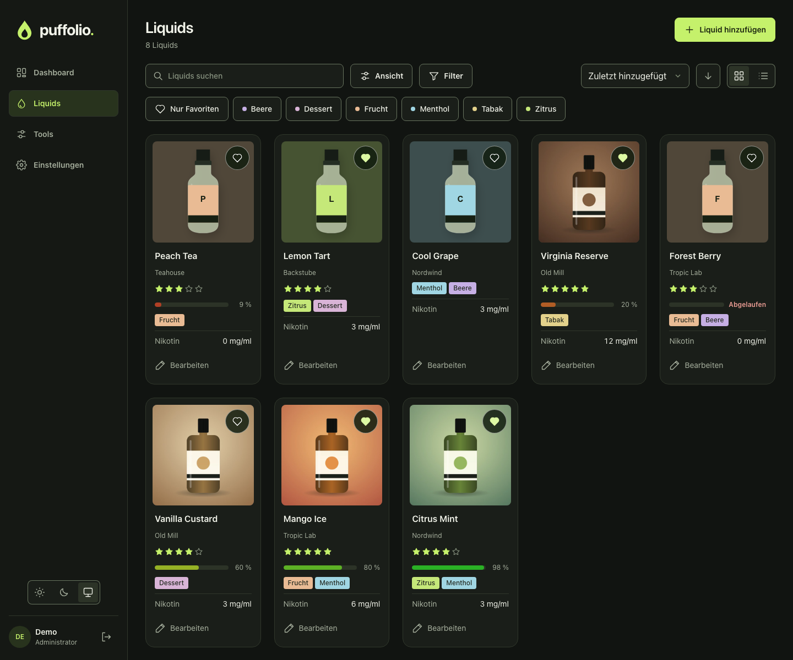
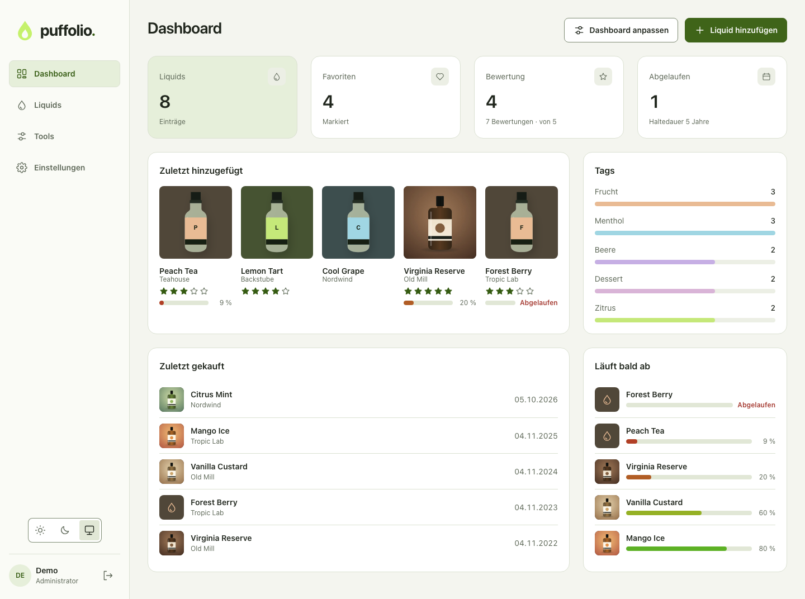

# Puffolio 0.2.0

Puffolio wird zur Sammlung mit einem Pfleger: Ein Administrator hält die Daten aktuell,
alle anderen können sie ohne Anmeldung ansehen. Statt der Füllmenge zeigt ein Balken,
wie viel der Haltedauer noch übrig ist. Die Oberfläche ist neu aufgebaut.

## Wichtig für bestehende Installationen

- **Die Sammlung ist nach dem Update für alle lesbar, die die Adresse erreichen.** Das
  betrifft Liquids, Notizen, Kaufdaten, Bewertungen, zugeschnittene Bilder und das
  Dashboard. Wer das nicht möchte, stellt Puffolio nicht öffentlich bereit oder setzt
  einen Zugriffsschutz davor.
- **Nur noch Administratoren können sich anmelden.** Einladungen und Nutzerverwaltung
  entfallen. Weitere Konten bleiben samt ihrer Daten in Datenbank und Sicherung erhalten,
  sind aber nicht mehr erreichbar. Besucher sehen die Sammlung des ältesten aktiven
  Administrators.
- **Die Haltbarkeit muss einmal eingerichtet werden:** unter Einstellungen → Felder →
  Haltbarkeit die Standardhaltedauer und das Kaufdatumsfeld wählen. Für die eigene
  Haltedauer je Liquid ein Zahlenfeld in Monaten anlegen und zuordnen. Neue Installationen
  haben das bereits.
- **Dashboard und Spalten bleiben unverändert.** Die neue Standardbelegung gilt nur für
  neue Installationen. Das Feld „Menge“ bleibt als normales Feld bestehen.
- **Bilder:** Vorhandene 4:3-Bilder werden mittig quadratisch angezeigt und beim nächsten
  „Ausschnitt ändern“ zum Quadrat. Exporte aus 0.1.0 lassen sich weiterhin importieren.
- `PUFFOLIO_BASE_URL` ist jetzt optional und sollte leer bleiben, solange keine feste
  Adresse erzwungen werden soll.

Das Datenbankschema ändert sich nicht. Trotzdem vor dem Update eine Instanzsicherung
anlegen: Ein Rollback besteht aus dem alten Image und dieser Sicherung.

## Neu

- **Besucher:** Dashboard, Liquids, Suche, Filter, Sortierung, Ansichten und Nikotinrechner
  ohne Anmeldung. Ändernde Bedienelemente entfallen, der Server erzwingt die Rechte.
- **Haltbarkeit:** Standardhaltedauer in den Einstellungen, je Liquid überschreibbar. Der
  Balken läuft ab Kaufdatum von Grün nach Rot, nach einem von fünf Jahren steht er bei
  80 %. Aufgebrauchte Liquids haben keinen Balken. Neue Widgets „Abgelaufen“ und
  „Läuft bald ab“, sortierbare Spalte „Haltbarkeit“.
- **Einstellungen:** Die Verwaltung ist darin aufgegangen; Sicherung und System liegen unter
  „Daten“. Sichtbarkeit der Felder direkt als Matrix umschaltbar.
- **Nikotinrechner:** ausschließlich mg/ml.
- **Bilder:** quadratisch, die Kacheln sind dadurch kompakter. Auf dem Desktop fünf Kacheln je
  Reihe, auf dem Smartphone zwei. Ohne Foto erscheint eine Flasche in der Farbe des Liquids.
- **Bedienung:** Tags als Filter-Chips, Klick auf die ganze Karte, sortierbare
  Tabellenspalten, fixierte Tabellenaktionen, „Rückgängig“ nach dem Löschen, mitlaufende
  Zeiträume in Datums-Widgets.

## Behoben

- Setup und Anmeldung schlugen mit „Herkunft nicht erlaubt“ fehl, wenn die App über die
  Server-IP statt über `localhost` aufgerufen wurde.
- Neu angelegte Felder erschienen nicht in Liste und Kacheln.
- Ein langsamer Upload oder Download blockierte alle anderen Schreibvorgänge.
- Bilder wurden bei jedem Aufruf in voller Größe neu geladen.
- Umlaute sortierten ans Ende, Kleinschreibung nach Großschreibung.

## Installation

Das Image `ghcr.io/buffer379x/puffolio:0.2.0` unterstützt `linux/amd64` und `linux/arm64`.
Die Assets `compose.yaml` und `puffolio.xml` gehören exakt zu dieser Version.
`image-digests.txt` enthält die unveränderlichen Image-Digests, `SHA256SUMS` die Prüfsummen
der beigefügten Dateien. Softwareinventare und vollständige Scanergebnisse liegen bei.

Anleitung: [Installation](https://github.com/Buffer379x/puffolio/blob/v0.2.0/docs/installation.md).
Den einmaligen Setup-Code zeigt das Container-Log. Das Datenverzeichnis muss lokal und für
UID99/GID100 beschreibbar sein. Bei HTTPS sichere Cookies aktivieren.

## Betriebsgrenzen

SQLite benötigt lokalen Speicher und einen einzigen schreibenden Puffolio-Prozess; SMB-/NFS-
Datenbanken und Unterpfade werden nicht unterstützt. Bilder dürfen maximal 8 MiB, 24 Megapixel
und 65.535 Pixel pro Seite haben. Öffentliche Anfragen sind außer der Anmeldung nicht
begrenzt; im offenen Internet gehört ein Reverse-Proxy davor. Sicherungen sind unverschlüsselt.

Das Unraid-Template wird mitgeliefert. Ein Test auf einem echten Unraid-Host steht weiterhin
aus; Container- und XML-Prüfungen ersetzen diesen nicht.

Details: [Sicherung und Wiederherstellung](https://github.com/Buffer379x/puffolio/blob/v0.2.0/docs/backup-restore.md).
