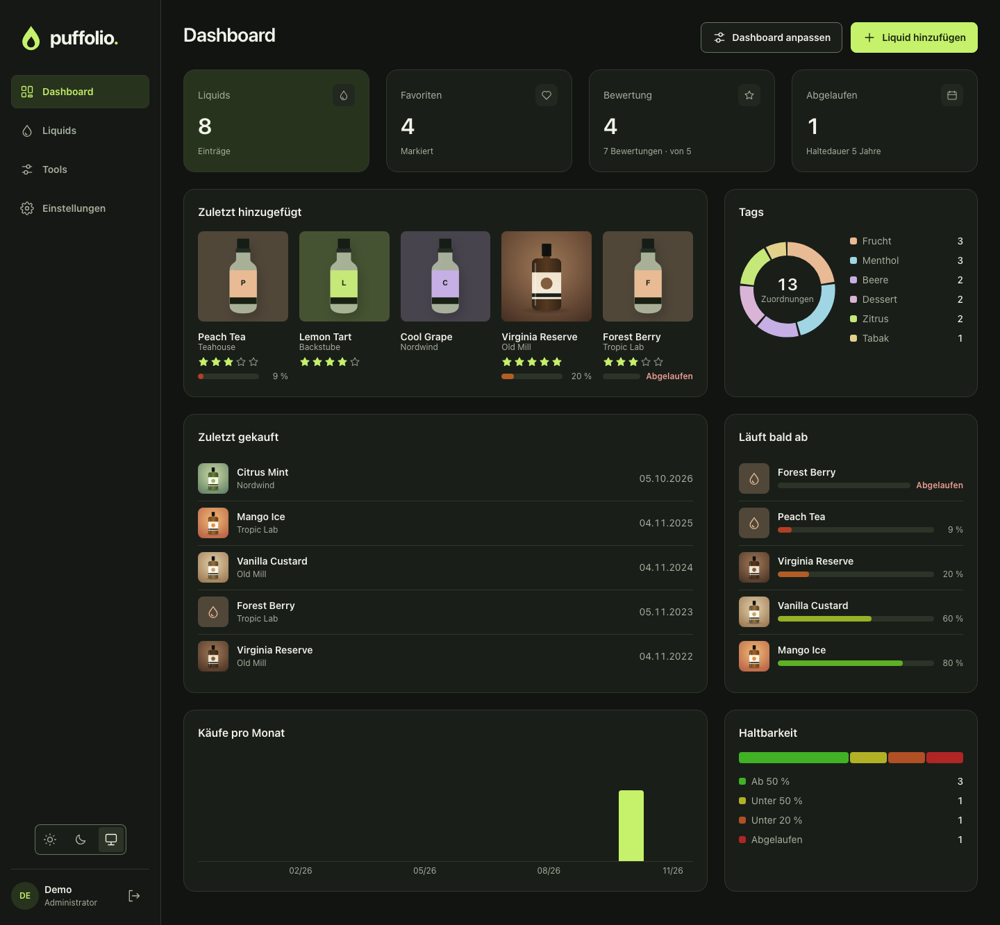

# Puffolio 0.3.0

Das Dashboard bekommt Statistiken und nutzt die Breite einheitlich aus.

## Neu

- **Kreisdiagramm:** verteilt die Liquids nach Tags, Auswahl (zum Beispiel Status), Textfeld
  (zum Beispiel Hersteller), Bewertung oder Ja/Nein. Ein Klick auf einen Tag in der Legende
  öffnet die gefilterte Liste.
- **Bewertungsverteilung:** Anzahl je Sternestufe.
- **Pro Monat:** Anzahl je Monat über ein Datumsfeld, die letzten zwölf Monate.
- **Haltbarkeit im Überblick:** wie viele Liquids noch ab 50 %, unter 50 %, unter 20 % oder
  abgelaufen sind.
- **Bestbewertet:** die höchsten Werte eines Bewertungs- oder Zahlenfelds.

## Geändert

- Jede Dashboard-Reihe füllt die volle Breite: Widgets wachsen im Verhältnis ihrer Größe.
  Ein einzelnes Widget in einer Reihe wird dadurch entsprechend breit.
- Der Button „Abmelden“ in den Einstellungen ist entfernt; er bleibt in der Navigation.
- `latest` zeigt nach jedem Release automatisch auf die neue Version. Wer im Unraid-Template
  `:latest` einträgt, bekommt so die Update-Anzeige.

## Behoben

- Nach dem Schließen eines Liquids aus der Liste erschien in Safari ein grüner Rahmen um die
  Tabelle.

## Update

Das Datenbankschema ändert sich nicht. Neue Widgets fügst du über „Dashboard anpassen“ hinzu; ein
bestehendes Dashboard bleibt, wie es ist. Vor dem Update eine Instanzsicherung anlegen: Ein Rollback
besteht aus dem alten Image und dieser Sicherung. Wer von 0.1.0 kommt, liest zuerst die
[Hinweise zu 0.2.0](https://github.com/Buffer379x/puffolio/releases/tag/v0.2.0).

## Installation

Das Image `ghcr.io/buffer379x/puffolio:0.3.0` unterstützt `linux/amd64` und `linux/arm64`. Die Assets
`compose.yaml` und `puffolio.xml` gehören exakt zu dieser Version. `image-digests.txt` enthält die
unveränderlichen Image-Digests, `SHA256SUMS` die Prüfsummen. Softwareinventare und vollständige
Scanergebnisse liegen bei. Anleitung: [Installation](https://github.com/Buffer379x/puffolio/blob/v0.3.0/docs/installation.md).

Ein Test auf einem echten Unraid-Host durch das Projekt steht weiterhin aus.
