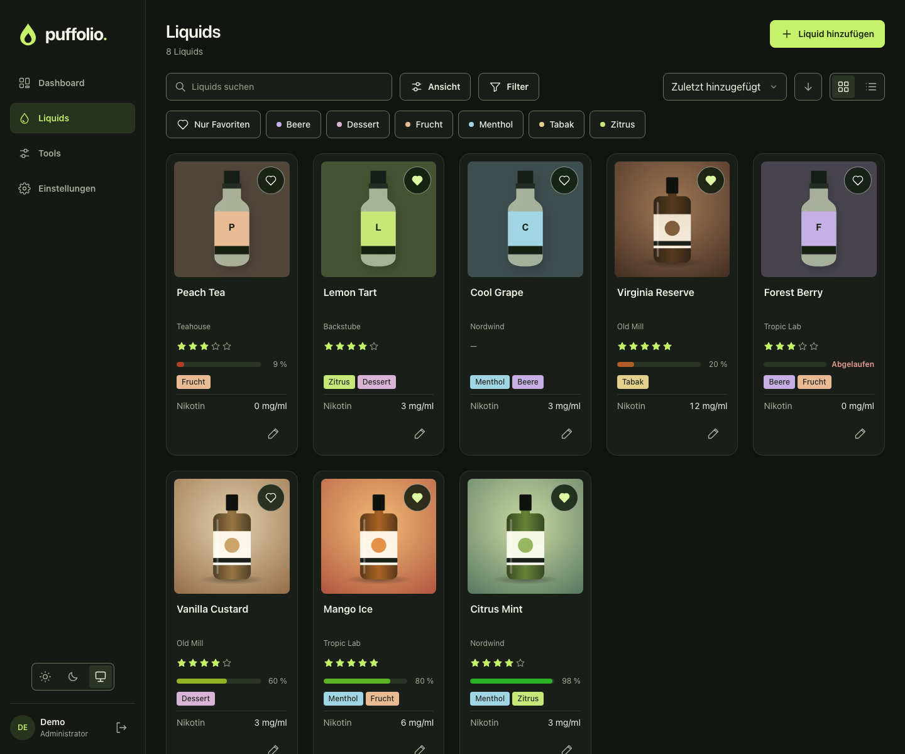

# Puffolio 0.4.0

Kacheln stehen sauber in Reihen, die Felder lassen sich in einer Vorschau anordnen, und Tags haben
32 Farben.

## Neu

- **Kachelvorschau:** Einstellungen → Felder zeigt eine Beispielkachel und die Reihenfolge ihrer
  Zeilen. Häkchen und Pfeile wirken sofort. Ein Hinweis nennt Felder, die im Dialog „Ansicht“
  abgewählt sind.
- **32 Tagfarben** statt 12, auf dem Desktop in acht Spalten, auf dem Smartphone in vier.

## Geändert

- **Kacheln:** Alle Karten einer Ansicht zeigen dieselben Zeilen, auf gleicher Höhe. Leere Felder
  behalten ihre Zeile und zeigen „—“.
- **Feldreihenfolge:** Die Kachel folgt jetzt der Reihenfolge aus den Einstellungen. Mit der
  Standardreihenfolge bleibt die Abfolge wie bisher.
- **Name:** Er belegt immer zwei Zeilen, längere Namen werden mit „…“ gekürzt. Der volle Name steht
  im Tooltip und in der Detailansicht. Das gilt auch für „Zuletzt hinzugefügt“.
- **Bearbeiten** in der Kachel ist nur noch ein Icon mit Tooltip.
- **Listen-Widgets:** Die Eintragszahl ist frei von 1 bis 10 statt 3, 5 oder 10.
- **Kennzahl-Widgets** tragen dieselbe Überschrift wie alle anderen; die erste Karte ist nicht mehr
  eingefärbt.
- **Kreisdiagramm:** Der Ring nutzt die Höhe des Widgets.

## Update

**Das Datenbankschema ändert sich.** Die Migration läuft beim ersten Start automatisch und ganz oder
gar nicht. Schlägt sie fehl, startet Puffolio nicht, und die Datenbank bleibt auf dem alten Stand.

- **Vorher eine Instanzsicherung anlegen** (Einstellungen → Daten).
- **Rollback nur mit dem alten Image und dieser Sicherung.** Eine migrierte Datenbank startet nicht
  mehr mit 0.3.0.
- Tags, Zuordnungen und Flaschenfarben bleiben unverändert.
- Sicherungen und Exporte älterer Versionen lassen sich weiter einspielen. Umgekehrt lehnt 0.3.0 die
  Archive von 0.4.0 ab.

## Installation

Das Image `ghcr.io/buffer379x/puffolio:0.4.0` unterstützt `linux/amd64` und `linux/arm64`. Die Assets
`compose.yaml` und `puffolio.xml` gehören exakt zu dieser Version. `image-digests.txt` enthält die
unveränderlichen Image-Digests, `SHA256SUMS` die Prüfsummen. Softwareinventare und vollständige
Scanergebnisse liegen bei. Anleitung: [Installation](https://github.com/Buffer379x/puffolio/blob/v0.4.0/docs/installation.md).

Ein Test auf einem echten Unraid-Host durch das Projekt steht weiterhin aus.
