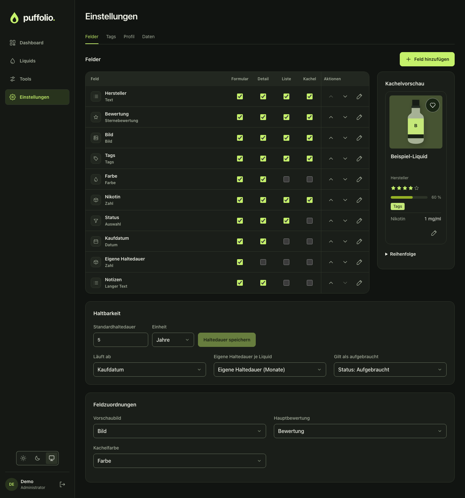

# Puffolio 0.4.1

Tags lassen sich löschen, die Farben laufen als Spektrum, und Feldtabelle und Kachelvorschau stehen
nebeneinander.

## Neu

- **Tags löschen:** Einstellungen → Tags hat dafür ein Papierkorb-Icon. Vorher erscheint immer eine
  Warnung. Sie nennt die betroffenen Liquids, auch die im Papierkorb, und bei Bedarf Pflichtfeld,
  Standardwert, Dashboard-Widgets und gespeicherte Ansichten.

  Der Tag verschwindet überall auf einmal, auch aus Standardwerten und Filtern. Filtert ein Widget
  oder eine Ansicht nur nach diesem Tag, zeigt es danach mehr Einträge. **Das lässt sich nicht
  rückgängig machen.** Die Warnung bietet vorher einen Export an, wenn der Tag zugeordnet ist.

  Verliert ein Liquid dadurch seinen letzten Tag in einem Pflichtfeld, gilt die Pflicht danach nur
  noch für neu angelegte Liquids. Die Warnung nennt das vorher.

## Geändert

- **Tagfarben:** Die 32 Farben laufen Zeile für Zeile als Spektrum von Rot bis Pink, Grau steht
  zuletzt. Bestehende Tags und Flaschenfarben behalten ihre Farbe.
- **Einstellungen → Felder:** Feldtabelle und Kachelvorschau stehen auf Desktop und Tablet
  nebeneinander, die Vorschau bleibt beim Scrollen stehen. Bei wenig Platz, etwa auf dem Smartphone,
  stehen sie weiter untereinander.
- **Liste „Reihenfolge“:** Sie ist unter der Kachel eingeklappt und öffnet sich per Klick.
- **Felder archivieren und löschen:** Beides liegt jetzt im Dialog „Feld bearbeiten“. In der Tabelle
  bleiben die Pfeile und „Bearbeiten“.

## Behoben

- Ein Link mit einem inzwischen gelöschten Tag zeigt die Liquids und einen Hinweis statt einer leeren
  Liste.

## Update

Das Datenbankschema bleibt gleich, eine Migration läuft nicht. Ein Rückweg auf 0.4.0 ist möglich,
und Sicherungen beider Versionen sind untereinander austauschbar.

## Installation

Das Image `ghcr.io/buffer379x/puffolio:0.4.1` unterstützt `linux/amd64` und `linux/arm64`. Die Assets
`compose.yaml` und `puffolio.xml` gehören exakt zu dieser Version. `image-digests.txt` enthält die
unveränderlichen Image-Digests, `SHA256SUMS` die Prüfsummen. Softwareinventare und vollständige
Scanergebnisse liegen bei. Anleitung: [Installation](https://github.com/Buffer379x/puffolio/blob/v0.4.1/docs/installation.md).

Ein Test auf einem echten Unraid-Host durch das Projekt steht weiterhin aus.
